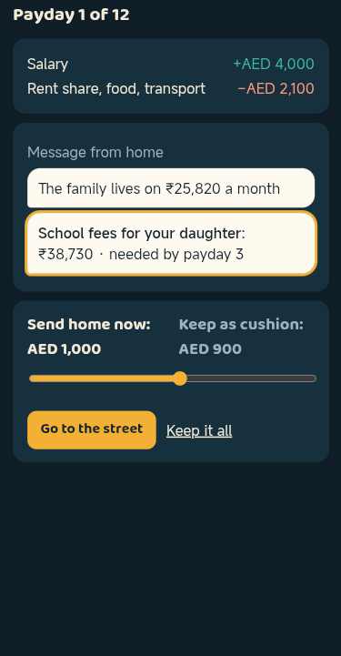
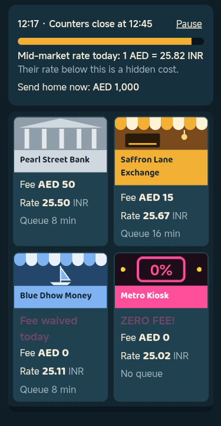
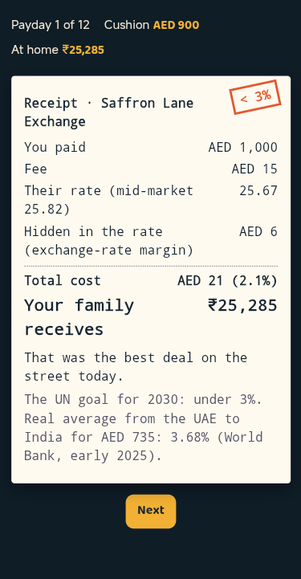
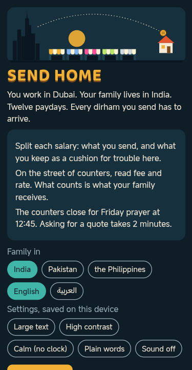
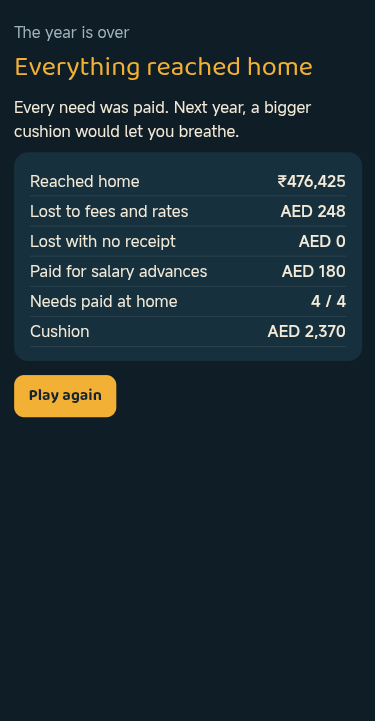
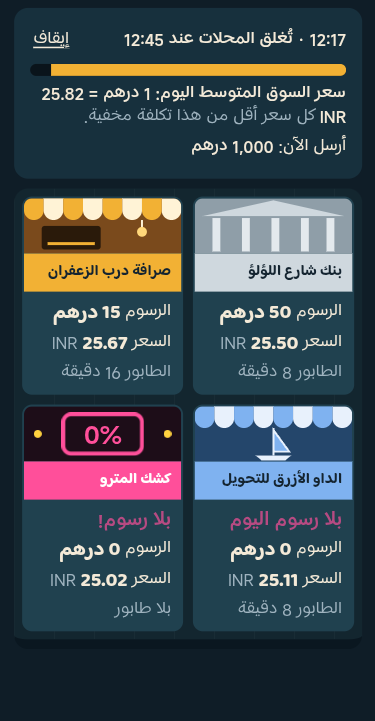

# Send Home

**Game Concept Document** for Zoud GameLab 2026, theme: Make FinLit Fun. Describes the build of 4 November 2026; it is updated with the build that is submitted.

[Play in the browser](https://designmaster-solutions.github.io/send-home-zoud/) · [Arabic edition](https://designmaster-solutions.github.io/send-home-zoud/?lang=ar) · [Game budget (separate document)](https://designmaster-solutions.github.io/send-home-zoud/docs/BUDGET.pdf) · [Source code](https://github.com/DesignMaster-Solutions/send-home-zoud)

## 1. Game Overview

Send Home is a short strategy game about the money that leaves the UAE every payday. You work in Dubai and your family lives in another country. For twelve paydays you decide how much to send and how much to keep, then you go out to a street of exchange counters with the Friday clock running. The only number that matters is what your family receives.

| | |
|-----------------|-----------------------------------------------------------------|
| **Title and genre** | Send Home (أرسِلها إلى البيت). Light strategy against the clock, one year in twelve paydays |
| **Platform** | Any browser today, by touch, mouse or keyboard, on a phone held upright or on a desktop. iOS and Android come with funding |
| **Audience** | People who live and work in the UAE and send part of each salary to family abroad, young people whose families do it, and the employers and programs that run financial wellbeing sessions for them |
| **Length** | A year of twelve paydays takes about 8 minutes, so it fits a break at work, a commute or a class |
| **Editions** | English and Arabic (right to left). The family lives in India, Pakistan or the Philippines, each with its real average cost of sending money from the UAE |

**Why this subject.** Personal remittances paid from the UAE reached USD 62.1 billion in 2025 (World Bank). For many people who live in the country, sending money home is a monthly habit, and the cost hides in two places at once: the fee on the board and the margin inside the exchange rate.

**What makes it different.** Of the 30 entries in this jam on 4 November 2026, five mention money sent home, as a budget line or an event (My DUNYA, Smart Phone: Money or Likes?, Rainy Day, ZARF Twelve Paydays, Future Me). They treat money for home as a line in a budget. Send Home makes the transfer itself the game: choosing the channel, reading the fee against the rate, the receipt, sending often or waiting, and the cash offer with no receipt. The board is a street of counters, not a spreadsheet.

## 2. Core Gameplay

**Objective.** Get what your family needs home in time, every month of the year, without falling into debt here. The best ending also leaves you holding a cushion of your own.

**Actions.** One slider, or the Enough and All buttons beside it, and a few taps: split the salary, ask a counter for a quote, send, read the receipt.

**The loop.** Each payday has four short steps.

1. **Payday.** AED 4,000 lands and AED 2,100 of rent share, food and transport go first. A message from home says what the family lives on each month and what is coming: school fees by payday 3, the roof before the rains by payday 6, the family festival by payday 9 (Diwali in India, Eid in Pakistan, Christmas and the balikbayan box in the Philippines), a father's hospital bill by payday 11. One slider splits the money you hold between "Send home now" and "Keep as cushion".
2. **The street.** You arrive at 12:15 and the counters close for Friday prayer at 12:45. The first Friday has no clock, so a new player learns the board before the queue counts. Up to six fictional counters show their fee, their rate and their queue: a bank, two exchange houses, a loud kiosk shouting ZERO FEE!, an app from payday 4 that needs a 15-minute ID check the first time, and from payday 2 a friend of a friend on the phone offering cash at a better rate with no receipt. Every day one counter waives its fee and quietly worsens its rate. The cheapest counter usually has the longest queue, and a counter whose queue is longer than the time left closes in front of you. Asking for a quote costs 2 minutes and answers the only question that matters: "For AED 1,000, your family receives...".
3. **The receipt.** What you paid, the fee, their rate against the mid-market rate, the cost hidden in the rate, the total cost in dirhams and in percent, what your family receives, and how much more the best counter on the street would have delivered that day. Next to it, the UN goal for 2030 (under 3%) and the real average from the UAE to your family's country.
4. **News from home.** The need that was due is paid ("They sent a photo") or missed, and the family either had what it needed this month or went short.

**Trouble here.** A broken phone screen you need for work, a clinic visit your insurance does not cover, your rent share going up, and one month the salary comes a month late while the bills do not. The cushion pays for them. What it cannot pay becomes a salary advance with a 10% charge, repaid first from the next salary.

| | | |
|-----------------------|-----------------------|-----------------------|
|  |  |  |
| Payday: split the salary | The street | The receipt |

**Decisions and progress.** Which counter, and is its queue worth the minutes? Send now or wait and pay the fee once? Send everything or keep a cushion for the month the salary is late? The year builds: the roof costs more than the school fees, the hospital bill comes with one payday of warning, and the app and the phone offer join the street. Four endings: "Home is safe, and so are you", "Everything reached home", "You kept standing" and "A hard year". The year closes with a summary in money: what reached home, what was lost to fees and rates, what was lost with no receipt, what salary advances cost, and the needs that were paid.

**Why it is fun to repeat.** The clock makes every payday a small race: read the board fast, ask the right counter, beat the queue. The street changes every payday and every year, so the cheapest counter is never in the same place. A year is short, and "Play again" is one tap away.

## 3. Financial Literacy Integration

There is no lesson screen. Three lines before the year starts, and after that every idea is a rule of the street that the player meets by playing.

| **Concept** | **The mechanic** | **What the player lives through** |
|---------------|-----------------------------|------------------------------------|
| Total cost = fee + exchange-rate margin | Every counter shows a fee and a rate, and the receipt splits the cost into both | A AED 15 fee at a fair rate costs less than a "free" transfer at a bad one |
| The mid-market rate is the yardstick | The street shows today's mid-market rate: "Their rate below this is a hidden cost" | The player learns to compare rates, not fees |
| "Zero fee" is a sales line | The loudest kiosk charges no fee and gives the worst rate, and the daily fee waiver comes with a worse rate | Always choosing ZERO FEE costs about 2.3 times more over the year (table below) |
| Fixed fees punish small transfers | A fee is charged on every transfer | With a AED 15 fee and a 0.5% margin, sending AED 300 costs 5.5% and sending AED 1,500 costs 1.5% |
| Emergency fund | Trouble here is paid from the cushion, or borrowed at a 10% charge | Sending everything feels generous until the month the salary is late |
| Licensed channels and receipts | The phone offer has a better rate, no receipt, and a 1 in 5 chance that the money never arrives (a game rule, not a statistic) | "The number does not answer any more", and there is nothing to claim |
| Planning to a deadline | Needs arrive with a due payday. Money left sitting at home partly gets spent on everyday things | Sending what is needed, when it is needed, beats sending early |
| Time costs money | Queues, the 2-minute quote and the 12:45 close | The cheapest counter is not always reachable |

**The outcome rewards the habit, not one lucky choice.** Six ways to play, each played by a robot for 300 seeded years with the game's own money model (`simulate` in `econ.js`, family in the base corridor, build of 4 November 2026). Amounts in AED over the year.

| **Way of playing** | **Reached home** | **Lost to fees and rates** | **Lost with no receipt** | **Cushion at the end** | **Months the family went short** | **Most common ending** |
|-----------------------------|------:|------:|------:|------:|------:|---------------------|
| Read the board, send what home needs, keep the rest | 18,341 | 281 | 0 | 2,496 | 1.0 | Home is safe, and so are you (93%) |
| Same plan, always at the ZERO FEE kiosk | 18,236 | 644 | 0 | 2,225 | 1.0 | Everything reached home (100%) |
| Send everything, every payday | 20,725 | 305 | 0 | 0 | 2.0 | You kept standing (81%) |
| Send all but a small AED 700 cushion | 20,102 | 298 | 0 | 700 | 2.6 | You kept standing (100%) |
| Same plan as the first, but the phone offer when it is there | 15,141 | -43 | 3,436 | 2,589 | 3.0 | You kept standing (72%) |
| Always hold AED 2,500 back | 18,478 | 270 | 0 | 2,500 | 4.0 | You kept standing (100%) |

Reading the board costs 1.5% of what was sent over the year, under the UN goal of 3%. Always choosing the ZERO FEE kiosk costs 3.4%, over it, and never leaves enough for the best ending. Sending everything delivers the most money, yet leaves the family short about twice a year, in the months when trouble here takes the money first, and pays the most for salary advances. The phone offer looks cheaper on every single transfer and still loses money in 88% of the years.

### What we hope players understand after playing

1. Judge a transfer by what the family receives, and compare the rate with the mid-market rate.
2. "Zero fee" is not free: the cost moves into the rate.
3. Keep a cushion here. Without one, the month the salary is late becomes expensive borrowing.
4. A receipt is protection. Cheap cash with no receipt can cost the whole transfer.
5. When home can wait, fewer and larger transfers pay the fixed fee fewer times.

Each lesson maps to something a person can do on the next payday: ask for "how much will they receive", look at the rate, keep a small cushion, and use a licensed channel that gives a receipt.

**Accuracy.** The real-world numbers on screen come from public sources listed in the README: the World Bank's Remittance Prices Worldwide for the average cost of sending AED 735 from the UAE in early 2025 (India 3.68%, Pakistan 1.42%, the Philippines 3.04%), the UN's SDG target 10.c for the 3% goal, and mid-market rates fixed on 4 November 2026. The salary, bills, family needs, counters, fees and margins are game values, set so that the bank costs more than the exchange houses, as it does in the World Bank data (AED 735 to India: banks 8.02%, transfer operators 2.81%). The 1 in 5 risk of the phone offer, the 10% advance charge and the share of money spent at home are game rules and say so in the code. The counters and the app are fictional: no real company is named or rated, and the game is not financial advice.

**UAE and Arabic edition, built during the jam.** The whole game runs in Arabic, right to left, and in English. Money is in dirhams for the player and in rupees or pesos for the family. Amounts use Latin digits in both languages, so a receipt reads the same in either. The clock is the UAE's unified Friday prayer time, 12:45 since 2 January 2026, set by the General Authority of Islamic Affairs, Endowments and Zakat ([The National, 10 December 2025](https://www.thenationalnews.com/news/uae/2025/12/10/uae-friday-prayers-timing-change-2026/)). Each family asks for its own festival (Diwali, Eid, or Christmas with a balikbayan box). The year ends with a "What is true in the UAE" panel: exchange houses need a Central Bank licence and must give a receipt with the rate and the fee, salaries go through the Wage Protection System and a late salary can be reported to the Ministry of Human Resources and Emiratisation, and hawala is legal only with a Central Bank certificate (sources in the README).

## 4. Visual Style & Player Experience

| | | |
|-----------------------|-----------------------|-----------------------|
|  |  |  |
| Title: home, language, settings | The year summary | The street in Arabic, right to left |

**Art direction.** A street at the end of a Friday morning, seen as a board of counter cards. Each counter has its own sign colour and the loud kiosk shouts in pink. The receipt is printed on paper, in a typewriter face, with a stamp that shows the cost against the UN goal of 3%. Everything is drawn in code, with no image files, so the game loads on a weak phone connection.

**Setting and tone.** Warm and fair. The player has no name, gender or nationality, so the year can be anyone's. Nobody is mocked for the choice they made, and the endings say what happened and what would change it.

**Sound.** Short synthesized sounds (WebAudio): a coin when money leaves, a tick in the last 5 minutes before 12:45, a stamp on the receipt, and a quiet music loop from Apple Loops that starts on the first tap. Sound off silences all of it. Every sound has a visual twin, so the game never depends on it.

**Interface.** One line at the top shows the payday, the cushion and what is at home in the family's currency. Counters differ by name, colour and text, not only by colour.

**Accessibility, on the title card and saved on the device.** Large text, high contrast, Calm (no clock), plain words ("mid-market rate" becomes "fair rate", "salary advance" becomes "borrowed money"; in Arabic too) and sound off. The street can be paused at any moment and the clock waits. Keyboard, mouse and touch all play the whole game. A teacher or a trainer can share the settings by link (`?a11y=large,calm`).

## 5. Development & Future Plans

**In the prototype today.** A full year of twelve paydays with six kinds of counters, four needs at home, four kinds of trouble here, salary advances, the receipt, the year summary and four endings. English and Arabic, three home countries, five accessibility settings and pause. An attract mode that plays a careful year by itself (`?autoplay`). Automated tests for the money model, the texts in both languages and the accessibility settings, and an end-to-end test that plays the whole year on a real Android phone. The public commit history shows it growing during the jam.

**Not done yet.** Art and sound are prototype level. No real players who send money home have tested it yet; two automated playthroughs by AI agents found ten problems, all fixed before submission (docs/PLAYTEST.md in the repository). The Arabic was drafted with AI and checked in the game on a real device, but no native speaker has reviewed it. The families' languages (Hindi, Urdu, Filipino) are not in the game. The mid-market rates are fixed for the jam. It runs only in the browser.

### Priorities, in order

The plan is six months and 980 hours, and the budget shows what ships at each funding level.

1. Three rounds of playtests with people who send money home from the UAE, with before-and-after questions on the five lessons above.
2. Review of the Arabic by a native speaker, and the game in the families' languages, starting with Hindi, Urdu and Filipino.
3. Real corridor data in one file, refreshed every quarter from the World Bank dataset, which already covers twelve destinations from the UAE (from India and Pakistan to Bangladesh, Egypt, Nepal and Sri Lanka). Sending AED 735 from the UAE to Bangladesh cost 6.22% on average in early 2025, above the 5% that SDG target 10.c says no corridor should cost.
4. A session mode for employers' financial wellbeing programs and for schools: no personal data, a 10-minute session plan and a printable debrief.
5. iOS and Android release, tested on low-end phones and playable offline.
6. Original art of the street and of home, and original music.

### Risks, and what we do about them

| **Risk** | **Our answer** |
|----------------------------------|---------------------------------------------------------------|
| Players enjoy it but do not learn | Before-and-after questions from the first playtest, a playtest report, and design changes if the answers do not move |
| The data goes stale | One data file with its source and date on screen, refreshed every quarter |
| The game reads as a rating of real providers | The counters stay fictional and the lesson is a method (compare what the family receives), so it stays true whichever provider a player uses |
| An error of fact or culture | Native review before any release outside the jam. The money rules and the texts live in separate files with their own tests |
| Our record is apps, not games | Art and sound go to specialists, and every stage is checked with players |

**Reaching players and paying for itself.** Players never pay: the web version stays free, with no ads and no data collected from them. Employers of migrant workers, financial wellbeing programs and public programs already pay for financial education, and they are who can sustain it, by licensing the session mode and editions for their workforce's corridors and languages. A new corridor is mostly one line of data from the World Bank dataset and a translation of the texts. We would not take money from a provider to appear on the street, so the lesson stays neutral. We have no customers or partners yet. Our first step is a free pilot of the web build with one UAE employer or program, using the before-and-after questions from the first playtest. Zoud, as the UAE's national financial wellbeing initiative, is the first place we would ask.

## 6. Your Team

**Alan De Bortolo (Brazil), Design Master Solutions LLC (Massachusetts, USA).** Solo entry; our first entry in this jam is [Snowball](https://designmastersolutions.itch.io/snowball). Send Home was built with an AI coding agent (Claude) under my direction: the code, the Arabic text, and drafts of the design and of this document, as disclosed in the submission. There are no AI-generated images, music or voice. The money model is checked by automated tests and the game is tested on real devices.

**Relevant experience.** The studio designs, codes, hosts and supports its own software products (Stone Project is live on iOS, Android, Mac, Windows and the web) and builds iOS and Android apps for clients, so store releases, support and localization are everyday work. Alan also builds LAPI, a personal and family finance app in Brazil (lapiapp.com), so how people really handle money is familiar ground.

**Support we would bring in.** Native speakers of Arabic, Hindi, Urdu and Filipino, people who send money home to shape and test each round, an illustrator, a composer, and trainers who run financial wellbeing sessions. All of it is in the budget.
